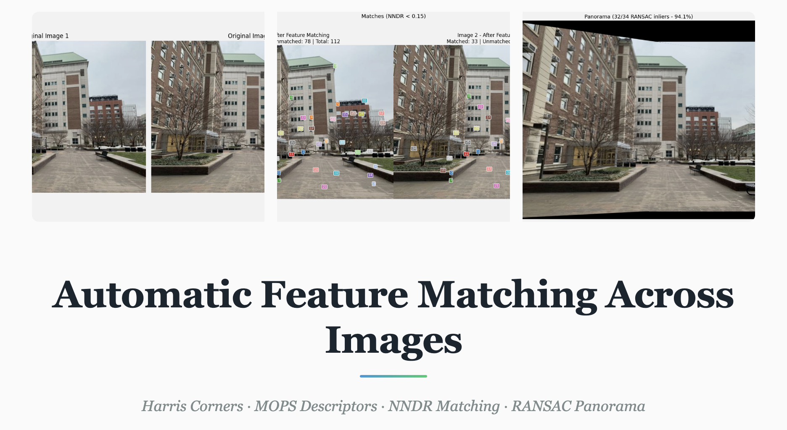

# Automatic Feature Matching Across Images




Automatic detection and matching of corresponding features across image pairs, following the "Multi-Image Matching using Multi-Scale Oriented Patches" paper by Brown et al.

---

## Overview

This implementation takes a pair of overlapping images and automatically finds corresponding feature points between them. The pipeline includes:

- **Harris Corner Detection** for interest point detection
- **Non-Maximal Suppression (NMS)** to retain only the strongest local corners
- **MOPS-style Feature Descriptors** — axis-aligned 8×8 patches sampled from a 40×40 window, bias/gain normalized
- **NNDR Feature Matching** using SSD with Lowe's ratio test
- **RANSAC Homography Estimation** for geometric verification
- **Panorama Stitching** with distance-weighted blending

---

## Directory Structure

```

├── webpage.pdf          # PDF version of webpage
├── code/
│   ├── main.ipynb           # main pipeline code
│   ├── harris.py            # Harris corner detector
│   ├── README.md            # this file
│   ├── environment.yml      # dependencies
│   └── data/                # input image pairs
└── web/
    ├── index.html           # project webpage
    └── assets/              # web assets
```

---

## Setup
```bash
conda env create -f environment.yml
conda activate cv
```

---

## Usage

Set image paths at the top of `main.ipynb`:
```python
impath1 = 'data/image1.jpg'
impath2 = 'data/image2.jpg'
```

Run all cells of the notebook.
Outputs are saved to `out/`.

---

## Results

- Harris corners before and after NMS visualized for both images
- NNDR histogram
- Top 5 feature matches patch comparisons (img1 descriptor | 1NN | 2NN)
- Feature matches visualized across both image pairs
- Panorama stitched from matched features via RANSAC homography